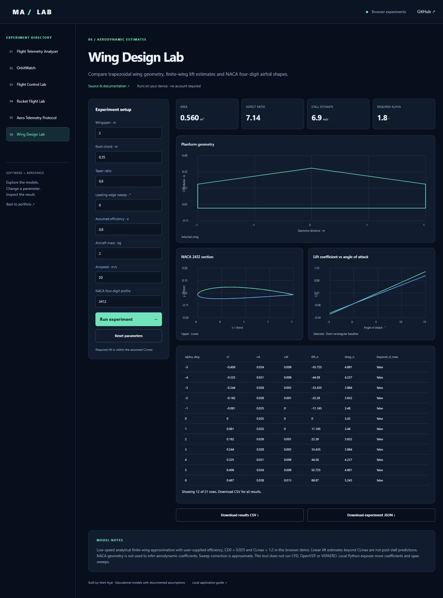

# Wing Design Lab

[Live browser demo](https://mertacar-git.github.io/wing-design-lab/) · [Portfolio laboratory](https://mertacar-git.github.io/portfolio/lab/index.html?project=wing-design-lab)

<details>
<summary>Actual application screenshot</summary>



</details>

## Browser and local editions

The public browser demo runs JavaScript models on-device. The local application uses Python and Streamlit. JavaScript numerical/protocol outputs are checked against committed Python reference fixtures. Satellite.js 6.0.1 is bundled with its license; no runtime CDN is required. Uploaded CSV data is processed locally in the browser.

Browser orbit crossings use sampling and bisection, with sampled culmination times; local Skyfield uses its event search. Browser rocket inputs use constant thrust; local Python also supports uploaded thrust curves. Browser wing coefficients are fixed to CD0=0.025 and CLmax=1.2; local Python exposes these and a span sweep. Browser telemetry has CSV/JSON analysis; local Python additionally groups alert intervals.

```sh
node --test docs/models.test.cjs
```

Serve `docs/` with any static server to run the browser edition locally. Example: `python -m http.server 8000 --directory docs`. Open http://localhost:8000.

## Model and features

- Trapezoidal planform, area, aspect ratio, tip chord and mean aerodynamic chord.
- Finite-wing lift slope, induced drag and a user-supplied profile drag coefficient.
- Required level-flight lift, estimated stall speed and lift-limit feasibility.
- Baseline design comparison, wingspan sweep and CSV/JSON exports.
- NACA four-digit profile geometry with cosine spacing and a closed trailing edge.

This is a low-speed analytical approximation, not a CFD, OpenVSP or VSPAERO solver. It assumes small angles and supplied efficiency, CD0 and CLmax values. The sweep correction is approximate; it uses the entered leading-edge angle. Profile geometry does not determine aerodynamic coefficients. Linear polar values beyond CLmax are marked as outside the lift limit and are not post-stall predictions. Structural weight, Reynolds effects, compressibility and spanwise loading are not modeled.

Tests check exact rectangular geometry, zero-angle lift, drag symmetry, stall-speed scaling, airfoil symmetry, trailing-edge closure and invalid geometry.


Educational aerospace/software project with an interactive application and validated core.

## Run locally

Python 3.12 recommended.

```sh
python -m venv .venv
# Windows: .venv\Scripts\activate
# macOS/Linux: source .venv/bin/activate
python -m pip install -r requirements.txt
python -m streamlit run app.py
```

## Test

```sh
python -m unittest discover -v
```

MIT licensed. Built with AI assistance; see the documented model and test assumptions before extending.
